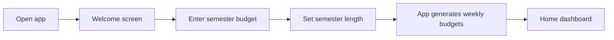
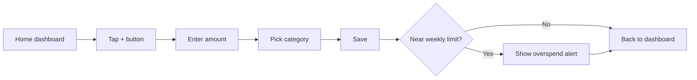
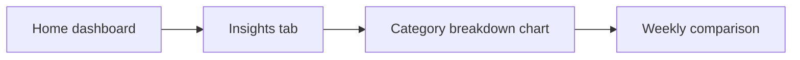

# User Flows

## Flow 1: First-time setup

## Flow 2: Add an expense

## Flow 3: View spending insights

## Screen list
1. Welcome / onboarding
2. Budget setup
3. Home dashboard (this week's remaining budget)
4. Add expense
5. Overspend alert
6. Insights
7. Settings / profile
